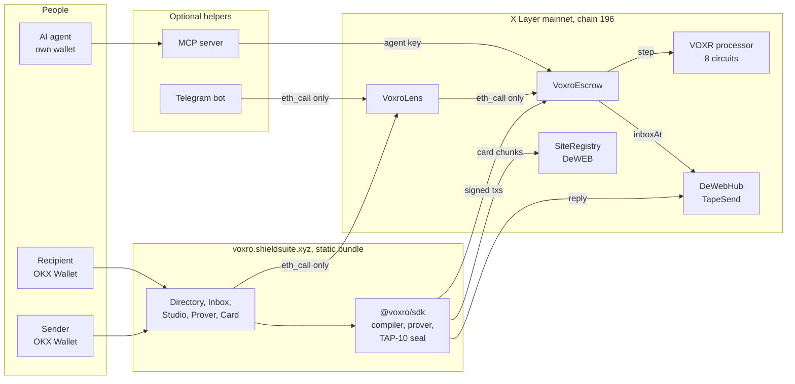
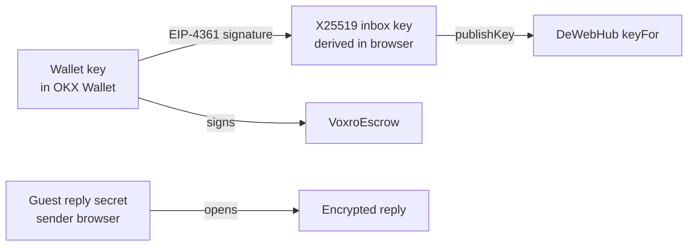
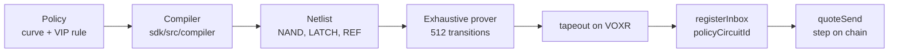
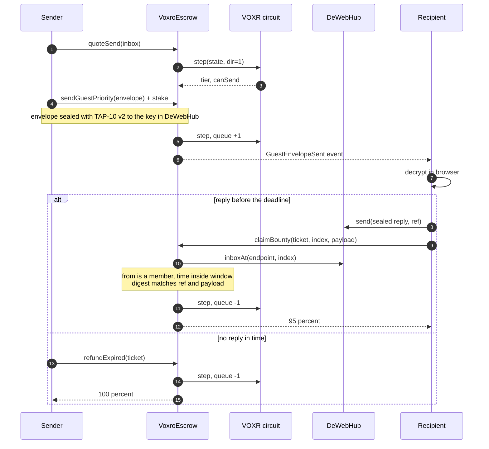
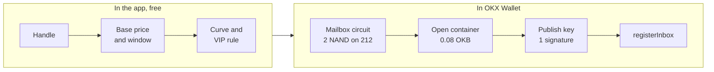

# Voxro

**A paid priority inbox with no server: senders lock USD₮0 to reach you, a TapeOut circuit sets the price, and only your encrypted reply releases it.**

Voxro turns attention into an escrow market on X Layer. Every inbox is priced by a small sequential circuit taped out on the VOXR processor: each unread paid message steps an onchain LATCH counter, and the quote climbs from 1× to 4× as the queue fills. The recipient answers through TapeSend, the escrow checks that reply onchain with no oracle, and pays 95%. Silence past the reply window refunds 100%. Every ticket is measured by one question: **was it answered or refunded, and can anyone verify which from chain data alone?**

Built for the X Layer TapeOut hackathon · A [ShieldSuite](https://shieldsuite.xyz) product · App: [voxro.shieldsuite.xyz](https://voxro.shieldsuite.xyz) · Demo: `<VIDEO_URL>` · Code: private repository, access on request

**Judges, start here:** open [voxro.shieldsuite.xyz/#/@voxro](https://voxro.shieldsuite.xyz/#/@voxro) to see the live quote for the first inbox, read from its circuit. Then open [#/prover](https://voxro.shieldsuite.xyz/#/prover), enter `#4@2.438` and press **Load & prove** to replay all 512 transitions of that circuit against X Layer in about 3 seconds. Neither needs a wallet. The in-app **Guide** (11 steps) walks through every page. During the private beta the site asks for an access code; the gate lifts at public launch.

---

## Four verbs, no wallet needed to see them

| Verb | What it is | Try it without a wallet |
| --- | --- | --- |
| **Price** | Pick a surge curve (gentle, balanced, steep, fortress) and a VIP rule. The compiler in `sdk/src/compiler/` emits an `InboxController` netlist (6 inputs, 7 outputs, 3 LATCH bits of state) and the browser proves all 512 `(state, input)` transitions before anything is spent. @voxro uses FounderBalancedInbox: a 10 USD₮0 base climbs 10 → 15 → 15 → 25 → 25 → 40 → 40 → 40 as its queue goes from 0 to 7. | `#/studio`: switch presets and watch the ladder, waveform and truth table change. |
| **Send** | Find an inbox in the Directory. `quoteSend()` runs the recipient's circuit on the current LATCH state and returns the exact price. The message is sealed in the browser with TAP-10 v2 (X25519 key exchange + XChaCha20-Poly1305 encryption) to the recipient's published key, and the stake is locked in `VoxroEscrow`. New senders use the **Guest Express lane**: no 0.08 OKB container needed. | `#/@voxro`: live quote, queue and reply window. Writing works; sending needs OKX Wallet. |
| **Settle** | The recipient decrypts locally, replies through `DeWebHub.send()`, then `claimBounty()` reads that reply entry from DeWebHub and checks three things onchain: the entry came from an inbox member, it landed inside the window, and `digest == keccak256(ref ‖ keccak256(payload))`. 95% to the recipient, 5% protocol. No reply in time: `refundExpired()` returns 100%. *Silence costs the sender nothing.* | `#/inbox` needs a wallet. The same loop runs from the CLI on an X Layer fork (see [Verified end to end](#verified-end-to-end)). |
| **Prove** | The Universal Prover loads any circuit on X Layer with its full REF closure, checks it against TAP-02 locally, and replays every transition through the processor's own `step()` via Multicall3. *The pricing rules cannot change after you pay, and you can check them before you do.* | `#/prover` → `#4@2.438` → **Load & prove**: 512 of 512 match onchain. |

### More to explore

| Feature | What it is | Where |
| --- | --- | --- |
| **Network Pulse** | Live X Layer telemetry: block, TapeOut processor count (451 on 2026-11-25), deploy, tape-out and container fees, DeWebHub, the compiled VOXR catalog (8 circuits, 157 NAND and 3 LATCH) and the in-browser prover (2,656 transitions, 0 mismatches). | `#/pulse` |
| **Create inbox** | Guided setup: name, price and window, extras, review, then up to five wallet steps: mailbox circuit, open container, publish key, register inbox, instant notifications. Steps already done are skipped. | `#/start` |
| **Contact Card** | A self-contained bio page for an inbox, published to X Layer `SiteRegistry` under `tape://<#ID>.2.<cpu>.tape`, with its 24,000-byte chunk plan and SHA-256 manifest. | `#/card` |
| **Circuit Gallery** | Every VOXR circuit with its netlist, REF targets, datasheet and a live bench that runs one `step()` beat locally and on chain. | `#/gallery` |
| **Receipt** | A verifiable receipt for any ticket from `VoxroLens.receipt()`: the ticket, the DeWebHub reply entry and the three claim checks. | `#/receipt/<ticketId>` |
| **Public profile link** | `voxro.shieldsuite.xyz/#/@handle` opens the Directory on that inbox, ready for an X, Telegram or GitHub bio. | `#/@voxro` |
| **Telegram bot** | [@VoxrolayerBOT](https://t.me/VoxrolayerBOT): `/price @h`, `/watch @h` alerts (new paid message, 6 hours left, claimed, refunded, declined) and a Mini App that signs with OKX Wallet through OKX Connect. It reads public chain data only. | `services/src/telegram.ts` |
| **AI agents** | An MCP (Model Context Protocol) server with `voxro_list_inboxes`, `voxro_get_inbox`, `voxro_send_message`, `voxro_check_reply` and `voxro_refund`, for agents with their own X Layer wallet. An x402 gateway that lets agents pay over HTTP is built and tested on a fork, and not yet public. | `services/src/mcp.ts`, `services/src/gateway.ts` |
| **CLI** | `voxro catalog`, `prove`, `quote`, `send`, `stress`, `inbox --decrypt`, `reply`, `refund`, `receipt`, `deweb plan`. | [`cli/README.md`](./cli/README.md) |

The app is bilingual (English and 简体中文), has dark (Obsidian) and light (Paper) themes, connects OKX Wallet through the injected provider or an OKX Connect deep link, and ships as one relative-path bundle with no CDN, web fonts or analytics, so the same build can be served from a DeWEB container.

## Why the TapeOut circuit is essential

- **No circuit, no provable price.** The quote is not Solidity arithmetic that someone could later change. `quoteSend()` calls `ICircuits(policyCpu).step(policyCircuitId, latchState, inputs)` on the taped-out controller ([`VoxroEscrow.sol`](./contracts/src/VoxroEscrow.sol), `_run`). Taped-out netlists are immutable, and 3 state bits with 6 inputs are small enough to prove exhaustively before signing.
- **No LATCH, no surge.** The queue lives in the circuit's own state bits. Every lock steps it up (`dir = 1`); every claim, refund or decline steps it down (`dir = 0`). The escrow stores those 3 bits and nothing else about pricing.
- **No TapeSend, no oracle-free settlement.** `claimBounty()` reads `DeWebHub.inboxAt(endpoint, index)` and recomputes the digest. The reply itself is the proof; no server or oracle attests to it.
- **No DeWEB, no serverless presence.** Contact cards live in `SiteRegistry` under `tape://` names (`sdk/src/deweb/`, `app/src/card/template.ts`), so a recipient's page has no hosting bill and no host to take it down.
- **No REF, no free composition.** Controllers compose the standard cells (`SaturatingQueue3`, `SurgeCurveDecoder`, `VipPassGate`) by reference: each is 6 NAND of glue around three REF cells, so inbox controllers reuse the shared cells for no extra transistor burn.

## Architecture

Voxro has four layers: a static client (`app/`), a TypeScript SDK that compiles, proves and seals (`sdk/`), two ownerless contracts on X Layer (`contracts/`), and optional helpers (`services/`, `cli/`). The client talks to the chain directly over public RPC; nothing in the money path runs on a Voxro server.

### System overview



Every write is signed by the person's own wallet in the browser. The escrow calls two external systems: the VOXR processor for the price and DeWebHub for the reply. VoxroLens and the Telegram bot only read.

### Who holds which key



| Key | Lives in | Can | Can never |
| --- | --- | --- | --- |
| Recipient wallet | OKX Wallet | Register and configure its inbox, reply, claim, decline | Move another inbox's stakes or change a taped-out circuit |
| Inbox X25519 key | Derived in the browser from a wallet signature, never stored | Decrypt messages to that inbox | Sign transactions |
| Sender wallet | OKX Wallet | Lock a stake, refund its own expired ticket (no keeper tip) | Reclaim a stake before the deadline, or after a valid reply |
| Guest reply secret | Sender's browser | Decrypt the reply to a Guest Express message | Touch funds |
| Agent key | The agent's own process (`VOXRO_AGENT_KEY`) | Send and refund for that agent | Leave the agent's machine: the MCP server signs locally |
| Deployer keystore | Foundry keystore | Nothing after deployment | Pause, upgrade or drain: the escrow has no owner and the treasury is immutable |

### From policy to price



A policy compiles to a TAP-02 netlist, is proven against the reference model in the browser, then taped out once. From then on every quote is a live `step()` on that exact netlist, which is why the Prover can check any inbox's rules by circuit id.

### A paid message, end to end



Claims and refunds are permissionless: any keeper may call them and earns a 0.1% tip (`KEEPER_BPS = 10`), taken from the 5% protocol share on claims, and nothing when senders refund themselves. The recipient can also `declineTicket()` early for an instant full refund.

### Creating an inbox



The mailbox circuit sits on a hub-compatible processor (Factory index 212) because DeWebHub only accepts processors created before Factory index 387; the pricing circuit stays on VOXR. Details: [`TAPEOUT_XLAYER_SPEC.md`](./TAPEOUT_XLAYER_SPEC.md) §3.4 and `sdk/scripts/scan-mailbox-cpus.mjs`.

### Verified end to end

- **Mainnet launch, 2026-11-21, 13:12:30 to 13:13:11 UTC:** 20 transactions in 41 seconds, blocks 76,497,714 to 76,497,755. The VOXR processor was created, the 8-circuit catalog taped out, `VoxroEscrow` and `VoxroLens` were deployed, and @voxro was registered as inbox #1 ([registerInbox transaction](https://www.oklink.com/x-layer/tx/0x4faa8becb72420f8a8270902608f8b66a6b16dc92a6adde904dd13658c8f60c1)).
- **The full paid loop** (send, decrypt, reply through the real DeWebHub, permissionless claim, Lens receipt with all three checks) runs in `contracts/test/Fork.t.sol` and in the CLI against an Anvil fork of X Layer ([`cli/README.md`](./cli/README.md), run of 2026-11-02).
- **No paid ticket has been settled on mainnet yet:** on 2026-11-25 `VoxroLens.dashboard()` reports 1 inbox and 0 tickets.

## Safety model

- **No owner, no upgrades.** `VoxroEscrow` has no admin role. The treasury address is immutable, and `withdrawProtocolFees()` can be called by anyone but only pays the treasury.
- **The recipient is whoever owns the inbox circuit NFT.** `recipientOf()` is `ownerOf(inboxCircuitId)`, so an inbox and its future payouts transfer like any ERC-721.
- **Hard limits in the contract:** reply window between `MIN_SLA` (1 hour) and `MAX_SLA` (14 days); at most `MAX_MEMBERS` (16) team containers; envelopes at most `MAX_ENVELOPE` (16,000 bytes) and must start with the TAP-10 v2 header; policy circuits must have exactly 6 inputs, 7 outputs and 3 state bits (`BadPolicyPins`).
- **Price protection.** The price is computed by the circuit inside the lock transaction and collected exactly: ERC-20 tokens are pulled with `transferFrom` (capped by the sender's approval), and native OKB must match to the wei or the call reverts with `BadValue`.
- **No double claims.** A reply entry can settle one ticket only (`ReplyConsumed`), and a TapeSend message can be locked once (`MessageAlreadyLocked`). All money paths are `nonReentrant`.
- **Kill switches.** The recipient can stop new messages with `setActive(false)` (`NotActive`), and the circuit itself refuses sends when its rule says so (`Paused`). Existing tickets can always be claimed or refunded.
- **Plaintext never leaves the browser.** Messages and replies are TAP-10 v2 sealed client-side; the chain stores ciphertext only.
- **Helpers hold no money keys.** The Telegram bot reads public chain data. The MCP server signs only with a key the agent supplies in its own environment.
- **Tests (2026-11-25):** Foundry 19 passed, 0 failed (13 escrow unit and fuzz tests including a 10,000-run conservation fuzz, plus 6 Community VIP tests). TypeScript 70 passed, 6 skipped (the skipped suites need a live fork or network).

## What's real and what's simulated

| Real | Simulated or not live yet |
| --- | --- |
| VOXR processor, 8 taped-out circuits, `VoxroEscrow`, `VoxroLens` and `TapeOutCommunityVip` on X Layer mainnet, all exact-match verified on Sourcify (2026-11-21) | No paid ticket has been settled on mainnet yet |
| Live quotes, queue depth and price ladders read from the circuits | The x402 payment gateway for agents is built and fork-tested, not yet public |
| The 512-transition replay in the Prover, against the chain via Multicall3 | The Studio's traffic waveform is a scripted burst, labelled on the page |
| TAP-10 v2 encryption, byte-identical to the vendored `@tapekit/send` under fixed randomness | The CLI's end-to-end run was on an Anvil fork of X Layer, not mainnet |
| The Telegram bot and its alerts | The demo film's settlement scene is a labelled animation (see `video/demo/README.md`) |

## Tech stack

Solidity 0.8.28 (OpenZeppelin 5.1, via-IR, 2,000 optimizer runs, Foundry) · TypeScript · viem 2 · @noble/curves and @noble/ciphers 2 · React 19 and Vite 8 · OKX Connect universal provider 1.9.1 · Vitest 5 · X Layer mainnet (chain 196) with TapeOut processors, DeWebHub (TapeSend, TAP-10 v2), SiteRegistry (DeWEB) and TAP-14 relays · Node services for Telegram and MCP · Remotion and ElevenLabs for the films.

## Run it locally

**Prerequisites:** Node 20 or later, pnpm 9, Foundry.

| Variable | What it does |
| --- | --- |
| `VITE_VOXR_CPU`, `VITE_VOXRO_ESCROW`, `VITE_VOXRO_LENS` | Override the deployed addresses. Unset: the app reads `contracts/deployments/xlayer.json` at build time. |
| `VITE_VOXR_CPU_INDEX` | Factory index of VOXR, used in `tape://` names. |
| `VITE_MAILBOX_CPU` | Hub-compatible processor for mailbox circuits. Default: `0xAa13…AF21` (index 212). |
| `VITE_RPC_URL` | RPC override, for example a local Anvil fork. Unset: public X Layer RPCs with fallback. |
| `VITE_TAPE_RELAY_URL`, `VITE_TAPE_RELAY_CONTAINER` | TAP-14 relay for instant notifications. Default: the reference relay. |
| `VOXRO_PRIVATE_KEY` | CLI writes only, environment variable only. Unset: read-only commands still work. |
| `VOXRO_ESCROW`, `VOXRO_LENS`, `VOXRO_RPC` | CLI address and RPC overrides. |
| `TELEGRAM_BOT_TOKEN`, `ADMIN_CHAT_ID`, `VOXRO_ORIGIN`, `BOT_DATA_DIR` | Telegram bot. |
| `VOXRO_AGENT_KEY` | MCP server: the agent's own funded X Layer wallet. Unset: read tools only. |
| `GATEWAY_KEY`, `GATEWAY_PORT`, `GATEWAY_DATA_DIR` | x402 gateway (key generated on the server, never committed; default port 4791). |

```bash
pnpm install
pnpm --filter @voxro/app dev        # http://127.0.0.1:5173, live X Layer mainnet
pnpm -r test                        # sdk, app, cli, services
pnpm --filter @voxro/sdk test:fork  # replay every circuit transition on an Anvil fork of X Layer
(cd contracts && forge test)
```

**Test status (2026-11-25):**

```
forge test --no-match-contract Fork   19 tests passed, 0 failed, 0 skipped (19 total tests)
@voxro/sdk       Tests  59 passed | 3 skipped (62)
@voxro/app       Tests  6 passed | 2 skipped (8)
@voxro/cli       Tests  4 passed (4)
@voxro/services  Tests  1 passed | 1 skipped (2)
```

## Deploying

1. **Contracts.** Import the deploy key once into a Foundry keystore (`cast wallet import voxro --interactive`), dry-run `script/Deploy.s.sol` on an Anvil fork, then broadcast to X Layer with `--verify --verifier sourcify`. The script creates VOXR through TapeOut Factory V2 (0.1 BEM deploy fee), mints transistors, tapes out the 8-circuit catalog, deploys the escrow and lens, and registers the flagship inbox. Budget and options: [`contracts/README.md`](./contracts/README.md).
2. **Addresses.** Commit `contracts/deployments/xlayer.json`; the app reads it at build time.
3. **Publish the flagship key.** Connect the deploy wallet, open **Inbox**, press **Publish key** (one signature, one gas-only transaction).
4. **Client.** `pnpm --filter @voxro/app build` and serve `app/dist/` as static files over HTTPS. The same bundle can be published to DeWEB with `voxro deweb plan`.
5. **Helpers.** `pnpm --filter @voxro/services build`, then run the Telegram bot and gateway under a process manager with their env files on the server.
6. **Live:** [voxro.shieldsuite.xyz](https://voxro.shieldsuite.xyz).

**Deployed on X Layer mainnet (chain 196), Sourcify exact match:**

| Contract | Address |
| --- | --- |
| VOXR processor (Circuits) | [`0xd47C…e581`](https://www.oklink.com/x-layer/address/0xd47C1A47d809438d66fd472cd2A30392ace4e581), Factory index 438 |
| VOXR transistors | [`0x32D7…8848`](https://www.oklink.com/x-layer/address/0x32D7B2566D1Ef037621a97bc854D5bCA963e8848) |
| VoxroEscrow | [`0xd463…73D5`](https://www.oklink.com/x-layer/address/0xd463a83b572AC72C8bE328069d61d2B19Cdf73D5) |
| VoxroLens | [`0xc994…5640`](https://www.oklink.com/x-layer/address/0xc994Cd83C3eA571d38Ed7EbDa8f30c05D06F5640) |
| TapeOutCommunityVip | [`0x49b7…D7E9`](https://www.oklink.com/x-layer/address/0x49b7c42C250ab1921E1e744aa72Dfd6D38FFD7E9) |
| DeWebHub (TapeSend, upstream) | [`0xe61A…25ee`](https://www.oklink.com/x-layer/address/0xe61A9C7213a6Aa616C246a2B569e555B417b25ee) |

## Repository map

```
Voxro/
├── app/                       React + Vite client (hash routes, EN + 简体中文)
│   ├── src/views/             Landing, Pulse, Directory, Start, Inbox, Card, Studio, Gallery, Prover, Receipt
│   ├── src/chain/             viem client, escrow reads and writes, telemetry, TAP-14 relay
│   ├── src/wallet/            OKX Wallet (injected) and OKX Connect
│   └── test/                  chain tests and fork end-to-end tests
├── sdk/                       @voxro/sdk
│   ├── src/tapeout/           TAP-02 netlist codec, simulator, X Layer addresses, fees, ABIs
│   ├── src/compiler/          policy → NAND/LATCH/REF compiler and exhaustive prover
│   ├── src/tapesend/          TAP-10 v2 seal and open, key derivation, DeWebHub client
│   ├── src/deweb/             SiteRegistry chunker and SHA-256 manifest
│   ├── src/channel/           TAP-14 channel records and relay notices
│   └── scripts/               catalog report, fork test, mailbox processor scan
├── contracts/                 Foundry
│   ├── src/VoxroEscrow.sol    attention escrow, LATCH state, reply verifier
│   ├── src/VoxroLens.sol      directory, tickets, receipts, onchain SVG
│   ├── src/vip/               VIP sources: ERC-721 holder, reputation, TapeOut community
│   ├── script/                Deploy.s.sol, DeployCommunityVip.s.sol
│   ├── test/                  unit, fuzz and X Layer fork tests
│   └── deployments/           xlayer.json
├── cli/                       voxro CLI: prove, quote, send, reply, refund, receipt, deweb
├── services/                  Telegram bot, MCP server, x402 gateway
├── docs/upstream/             vendored TAP-02, TAP-10, DeWebHub.sol, @tapekit/send
├── video/                     Remotion teaser and demo film (sources only)
├── TAPEOUT_XLAYER_SPEC.md     verified X Layer addresses, ABIs and fee formulas
└── CIRCUITS_AND_CONTRACTS.md  gate-level circuit specs and contract design
```

## Pre-existing work and credits

- **TapeOut protocol:** TAP-02 netlists, TAP-10 TapeSend and TAP-14 channels, plus the TapeOut Factory, processors, Opener, DeWebHub and SiteRegistry, which are deployed third-party contracts on X Layer. The normative texts and the `DeWebHub.sol` and `@tapekit/send` sources are vendored in [`docs/upstream/`](./docs/upstream/README.md) under their licenses (CC0-1.0 for specs, MIT for code).
- **OpenZeppelin Contracts 5.1** (MIT) and **forge-std** (MIT / Apache-2.0).
- **USD₮0, USDT and OKB** token contracts on X Layer; **OKX Wallet** and **OKX Connect** for signing.
- No prior Voxro code: everything in this repository was written for this hackathon, starting 2026-11-01.

## License

No open-source license has been chosen yet. All rights reserved by ShieldSuite.

---

Voxro is beta software on mainnet. The contracts are verified but not audited; use small amounts.
